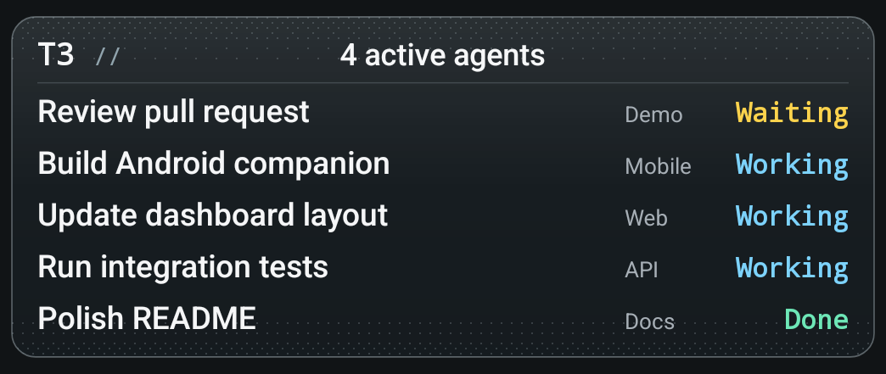

# T3 Android Activity

An unofficial, community-made Android companion for [T3 Code](https://t3.codes/). See which coding agents are working, waiting for you, or recently finished without unlocking your phone.

The glass lock-screen mode uses a live wallpaper with larger typography, aligned colored statuses, a translucent card and subtle terminal-inspired dithering. It runs alongside the regular T3 app; it does not modify or replace it.



*Actual emulator preview with fictional chat titles.*

## Requirements

- Android 16 or newer (API 36). Developed on a Pixel 8a; lock-only live wallpaper support and notification behavior vary by device.
- T3 Code running locally on a Mac with Python 3 (3.10+). The Mac and phone must be on the same private Wi-Fi network.
- The Mac must stay awake and able to reach the phone. Cellular and remote access are not supported by this release.

## Install

1. Download `t3-activity.apk` from [Releases](../../releases/latest). Open it on your Android phone and allow installation from that source if Android asks. This is a signed, sideloaded APK, not a Play Store app.
2. Download this repository's ZIP from GitHub, unzip it on your Mac, and open Terminal in the extracted folder. Run:

   ```bash
   python3 setup_mac.py
   ```

   The installer detects your private Wi-Fi address, creates a unique certificate and token and starts a login LaunchAgent. It prints the location of your **private** `pairing.json`.
3. Transfer that file locally to the phone (USB file transfer or your preferred trusted local file-transfer method). Open **T3 Activity → Import Mac pairing file** and select it. Tap **Test connection**. Delete the transferred copy after importing. Don't post or share the pairing file.
4. Optional: tap **Choose wallpaper image** to import your own background. The app otherwise uses a dark solid background. Tap **Set glass lock screen** and allow notifications, then choose **Lock screen only** in Android's wallpaper picker. Your original wallpaper is not overwritten as a file, but this replaces the selected lock-screen wallpaper. If your phone lacks a lock-only choice, consider the notification mode instead.
5. Lock your phone. The card updates roughly every 15 seconds while its foreground monitor runs.

No USB debugging, root, server account, or T3 account credentials are required.

## Other display modes

- **Native live card:** uses Android's promoted ongoing notification when supported. Enable full lock-screen notification list and silent notifications if needed. Android controls expansion and typography.
- **Styled notification card:** a custom, expandable notification in the notification shade.
- **Home-screen widget:** select T3 Agent Activity from the system widget picker. Some Android builds offer a separate lock-screen widget panel.

Glass mode is a non-interactive display, not a system widget. It can coexist with the clock and fingerprint reader; the notification shade and other lock-screen notifications can cover the card. The silent foreground-monitor notification is hidden from the lock screen in glass mode.

| Status | Color |
| --- | --- |
| Working | Blue |
| Waiting / Approval | Amber |
| Input | Lavender |
| Done | Green |
| Failed | Red |

Waiting includes background work and PR watches. Recent unsettled completions remain visible for 15 minutes. The five-row card prioritizes requests requiring attention and keeps a completion visible when space permits. The header counts only active agents.

## Privacy

The Mac bridge reads T3's local SQLite projections in read-only mode and exposes only chat titles, project names and status. It binds to a specific private IPv4 address, serves HTTPS with a locally generated certificate, and requires a random bearer token. The phone trusts the imported certificate and validates the endpoint hostname. No cloud service or telemetry is included.

Lock-screen glass mode deliberately displays titles without unlocking the phone; anyone who can see the screen can read them. Only enable it if you are comfortable with that. The pairing file grants access to the activity feed, so treat it as a password. Runtime credentials live outside the repository in `~/Library/Application Support/T3AndroidActivity/`.

## Troubleshooting and removal

- If you cannot connect, check Wi-Fi, Mac firewall settings, and whether T3 is running. Guest networks that isolate devices will not work. Use `python3 setup_mac.py --address <private-ip>` if the wrong interface was detected.
- If the Mac's private IP changes, run setup again and import the new pairing file. Run it with `--rotate` if you want to revoke an existing pairing or renew the certificate. Certificates last one year.
- If port 8766 is in use, run setup with `--port 8767` and re-import the pairing file.
- Reopen the phone app after a device restart if updates stop. Tap **Stop updates** to stop polling; choose your previous wallpaper in Android's settings to restore it.
- To stop and remove the Mac login service, run `python3 setup_mac.py --uninstall`. The private pairing files remain in the application-support folder; you can delete that folder if you no longer need them.
- The bridge depends on T3's internal local database schema, which is not a stable public API; a T3 update may require a companion update. It never writes to the database.

## Build from source

Install JDK 21, Android SDK Platform 36 and Android build tools 35.0.0 (or set `ANDROID_BUILD_TOOLS`). Set `JAVA_HOME` and `ANDROID_HOME` if not already configured.

```bash
python3 -m unittest -v
./build.sh
```

The build produces `build/aligned.apk` (unsigned). To sign it with your own Android signing key, set `T3_SIGNING_KEYSTORE` to your keystore path and `T3_SIGNING_PASSWORD` to its password before running `./build.sh`. The signed APK is `build/t3-activity.apk`. Keep signing material outside this repository. The distributed release uses a dedicated release key; self-built APKs signed with another key cannot update it in place.

## Project status

Community experiment, not affiliated with or endorsed by T3 Code. Mac + Android 16 is the initial supported configuration. Issues and contributions are welcome.

MIT licensed.
